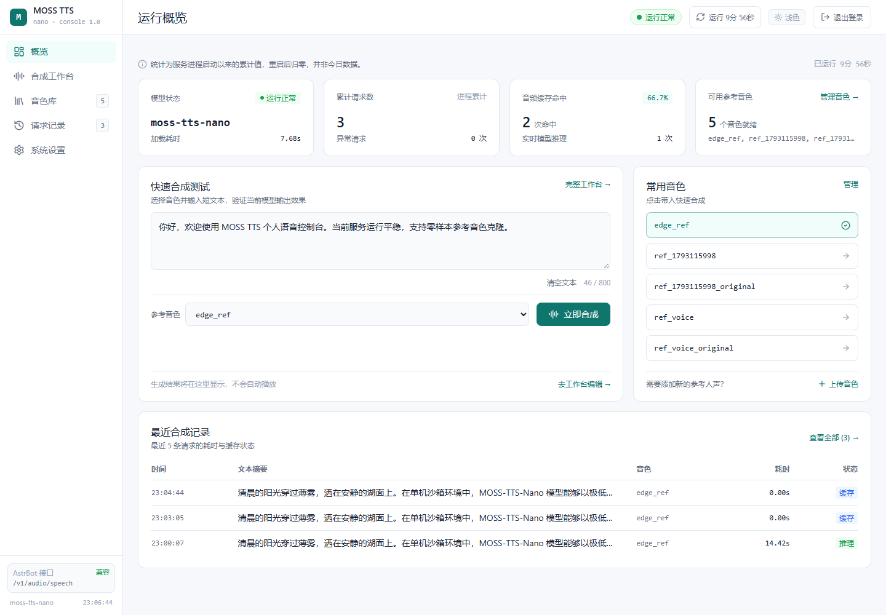
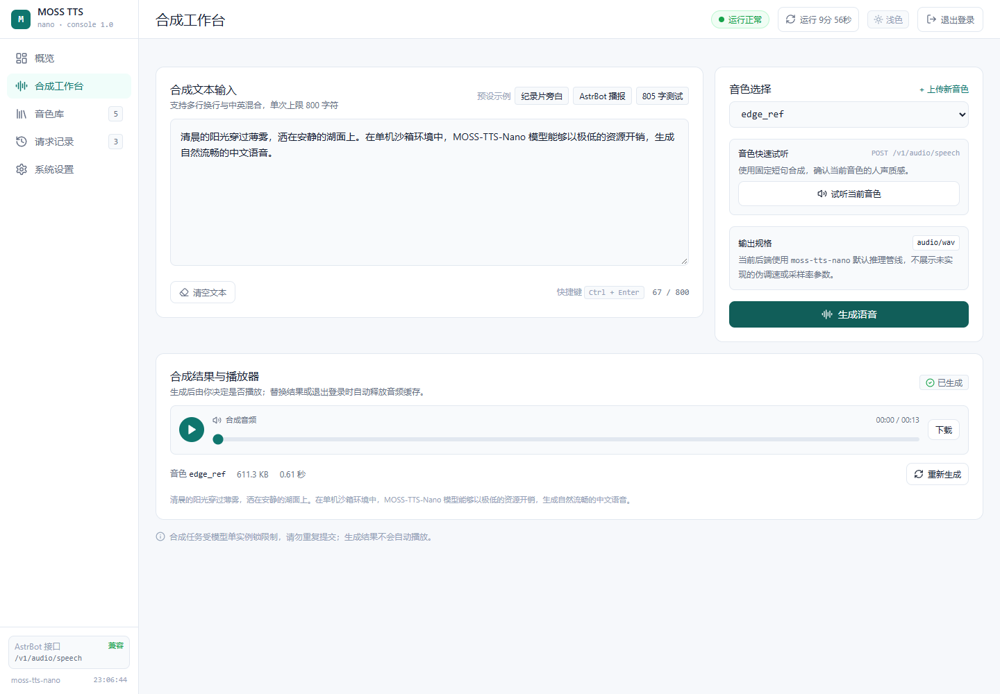
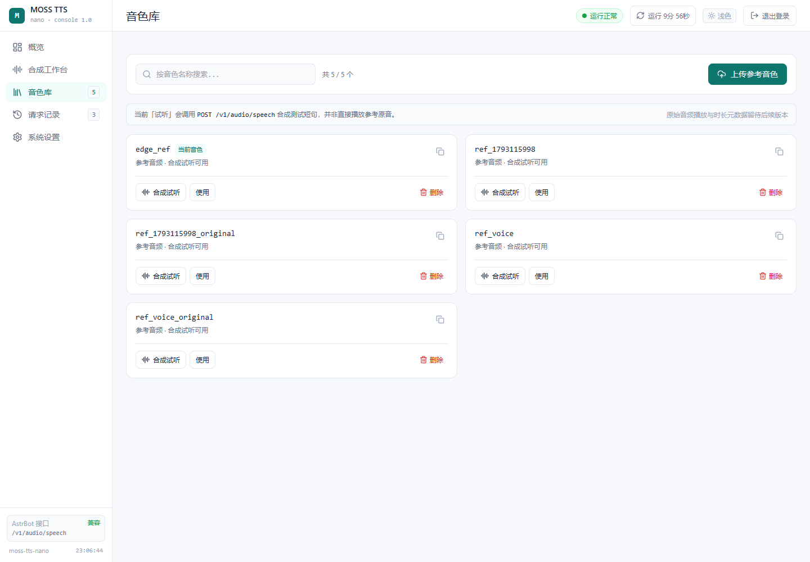

# MOSS TTS 控制台

面向个人单实例部署的 MOSS-TTS-Nano 管理控制台。提供运行状态、语音合成、音色上传与最近请求记录，保持 OpenAI 兼容 TTS 接口不变。

## 界面预览







## 技术栈

- Vue 3 + TypeScript + Vite
- Naive UI
- Vue Router（Hash 模式）
- TanStack Vue Query
- Vitest

## 功能

| 页面 | 功能 |
| --- | --- |
| 运行概览 | 模型状态、累计请求、缓存命中、音色数量、快速合成、最近记录 |
| 合成工作台 | 800 字输入校验、音色选择、快速试听、合成、播放与下载 |
| 音色库 | 搜索、上传参考音频、合成试听、切换使用、删除确认 |
| 请求记录 | 最近 30 条内存请求、耗时、大小、缓存状态 |
| 系统设置 | 自动刷新、刷新频率、Token 存储、只读接口信息 |

## 开发

要求 Node.js 22+。

```bash
npm install
npm run dev
```

开发服务器默认运行在 `http://localhost:5173/admin/`，并代理本机 `127.0.0.1:8000` 的管理与 TTS 接口。

如果前端和 API 不同源，可配置：

```bash
cp .env.example .env
# VITE_API_BASE_URL=https://your-tts-host.example.com
```

## 构建

```bash
npm run typecheck
npm test
npm run build
```

构建产物位于 `dist/`，资源路径前缀为 `/admin/`。

## 后端接口要求

所有管理接口使用 Bearer Token：

```text
Authorization: Bearer <TTS_TOKEN>
```

| 方法 | 路径 | 用途 |
| --- | --- | --- |
| GET | `/admin/stats` | 服务状态、统计、音色和最近记录 |
| POST | `/admin/voices` | multipart 上传 `name` 与 `file` |
| DELETE | `/admin/voices/{name}` | 删除音色 |
| POST | `/v1/audio/speech` | OpenAI 兼容语音合成，返回 `audio/wav` |
| GET | `/health` | 基础健康检查 |

`/v1/audio/speech` 保持现有请求与响应格式，AstrBot 无需修改配置。

## 部署

将 `dist/` 内容放到 FastAPI 服务的 `web/dist/`，并让服务提供：

- `/admin`：返回 `web/dist/index.html`
- `/admin/assets/*`：返回静态资源

FastAPI 参考写法：

```python
from fastapi import FastAPI
from fastapi.responses import FileResponse
from fastapi.staticfiles import StaticFiles
from pathlib import Path

BASE = Path("/data/workspace/moss-tts")
DIST = BASE / "web" / "dist"
app = FastAPI()

if (DIST / "assets").is_dir():
    app.mount("/admin/assets", StaticFiles(directory=DIST / "assets"), name="admin-assets")

@app.get("/admin", include_in_schema=False)
def admin_page():
    return FileResponse(DIST / "index.html")
```

路由使用 Hash 模式，因此浏览器访问地址形如：

```text
/admin#/
/admin#/workbench
/admin#/voices
/admin#/records
/admin#/settings
```

不需要额外配置 SPA history fallback。

## 安全说明

- Token 默认只写 sessionStorage；勾选“记住”后才写 localStorage。
- Token 只通过 `Authorization` 请求头发送，不写入 URL。
- 401 会清理会话、查询缓存与音频 Blob URL。
- 页面不提供 Shell、环境变量编辑或任意文件读取。
- 音色名、文本和错误信息均按不可信输入渲染，不使用动态 HTML 注入。

## 项目结构

```text
src/
├── api/              API 客户端与错误解析
├── audio/            合成请求与 Blob URL 生命周期
├── auth/             Token 会话
├── components/       布局、登录、播放器、上传抽屉等
├── composables/      状态查询、轮询、全局上下文
├── router/           Hash 路由
├── stores/           工作台状态
├── utils/            格式化与输入校验
├── views/            五个页面
├── App.vue
├── main.ts
└── styles.css
```

## 兼容性

- 不修改 MOSS-TTS-Nano 模型、推理线程、缓存策略和 systemd 服务。
- 不改变 AstrBot 使用的 `/v1/audio/speech` 接口。
- 旧版单文件面板可保留为独立回退入口。

## License

MIT
